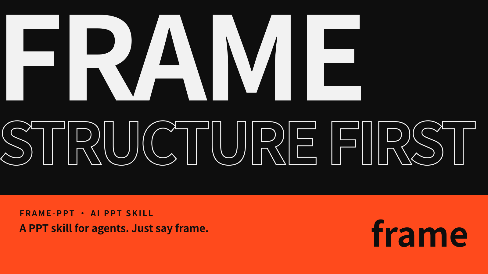
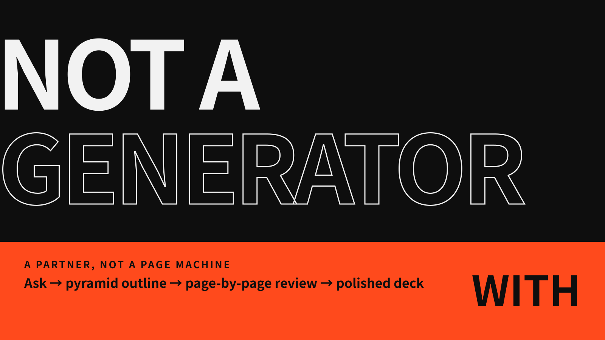
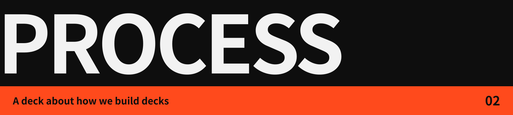
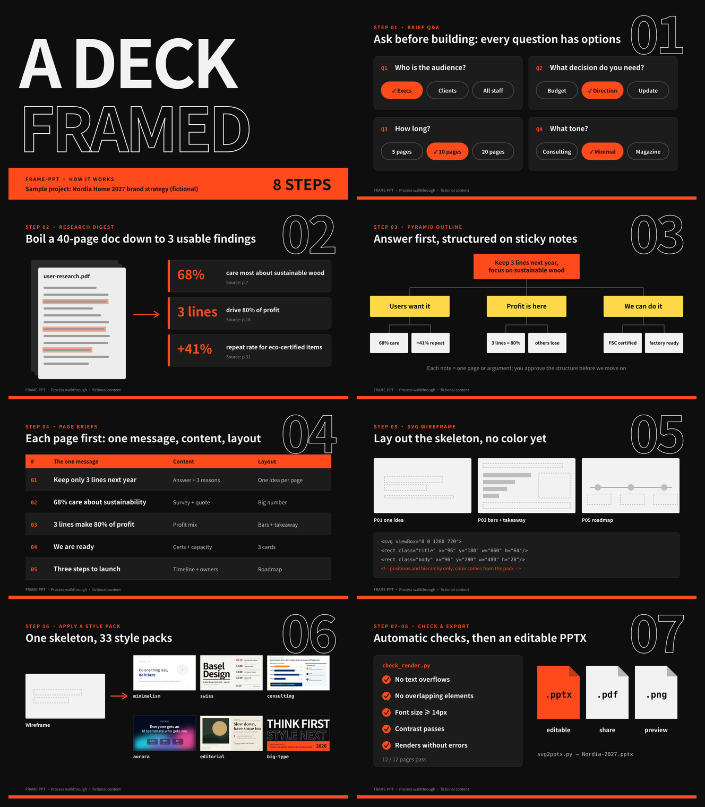
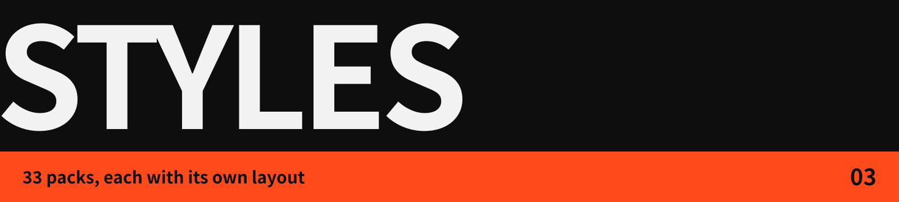
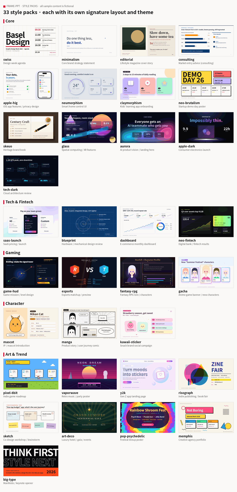

English | [简体中文](README.zh-CN.md)





**frame-ppt works with you to structure the deck. It is not a one-click page generator.** It asks about your brief first, then builds a pyramid-principle outline. Each page waits for your sign-off before the final design is produced.


Paste this to your agent (Claude Code, Codex, etc.):

```
Install this PPT skill for me: https://github.com/ottoprua/frame-ppt
```

Or install it manually:

```bash
git clone https://github.com/ottoprua/frame-ppt.git ~/.claude/skills/frame-ppt
```

Then say **`frame`** to your agent to start.



This 9-slide deck (a cover plus 8 steps) was made with frame-ppt, and it shows how frame-ppt builds a deck: brief Q&A, research digest, pyramid outline, page briefs, SVG wireframes, style packs, then checks and export. Full-size slides are in [docs/images/process/en](docs/images/process/en).





There are 33 style packs, each with its own signature layout and theme. All brands and data in these images are fictional examples.



**Optional: illustrations and generative backgrounds (step 6.5, off by default).** frame-ppt can leave slots on a slide for illustrations, product line art or backgrounds. Backgrounds such as dot networks, flow lines and halftone are generated locally from the deck's colour tokens. Illustrations can be handed to another agent or image tool through a file manifest. Each style pack has a prompt preset that is combined with your project's subject, and paid image calls always need your confirmation first. Returned single-colour art is recoloured to the pack's palette. If an image is missing or fails a check, the slide falls back to the built-in SVG.

---

Apache-2.0 License · Credits and third-party notices in [NOTICE.md](NOTICE.md)
