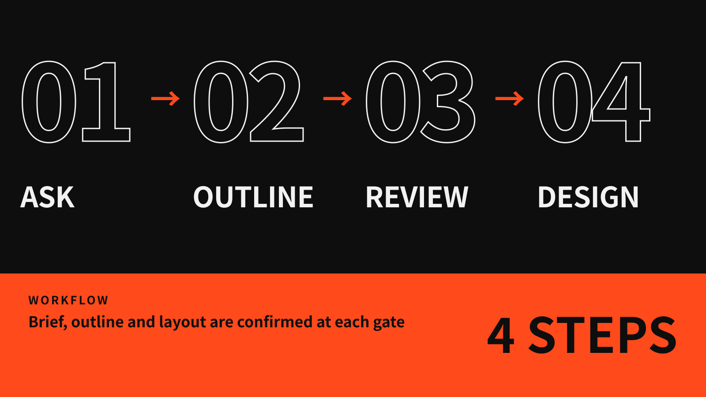

English | [简体中文](README.zh-CN.md)


**frame-ppt works with you to structure the deck. It is not a one-click page generator.** It asks about your brief first, then builds a pyramid-principle outline. Each page waits for your sign-off before the final design is produced.




Paste this to your agent (Claude Code, Codex, etc.):

```
Install this PPT skill for me: https://github.com/ottoprua/frame-ppt
```

Or install it manually:

```bash
git clone https://github.com/ottoprua/frame-ppt.git ~/.claude/skills/frame-ppt
```

Then say **`frame`** to your agent to start.


There are 33 style packs, each with its own signature layout and theme. All brands and data in these images are fictional examples.


Full-resolution slides (3840×2160) are available in Releases.

---

MIT License · Credits and third-party notices in [NOTICE.md](NOTICE.md)
