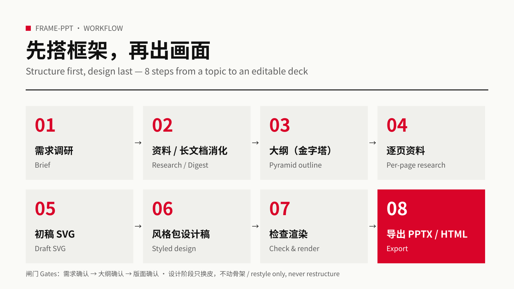
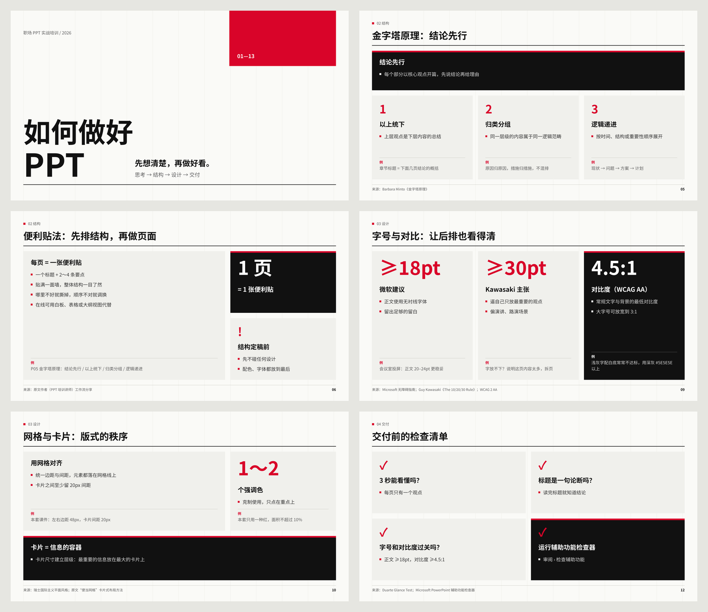
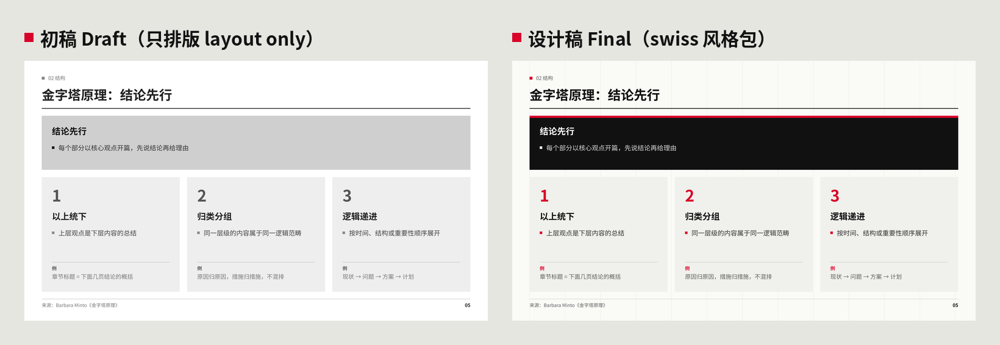
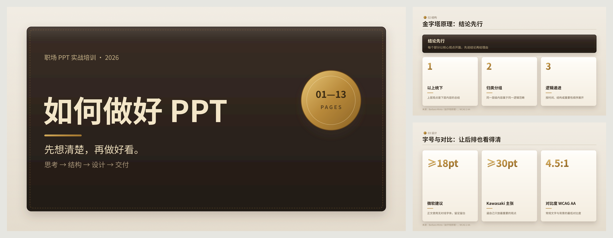
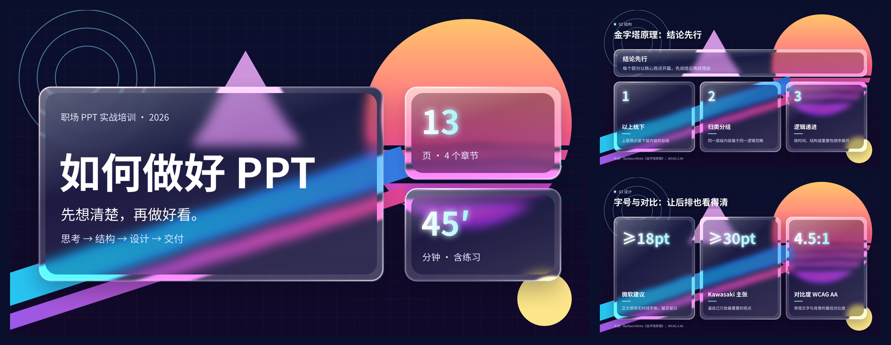
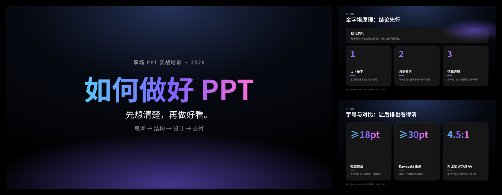
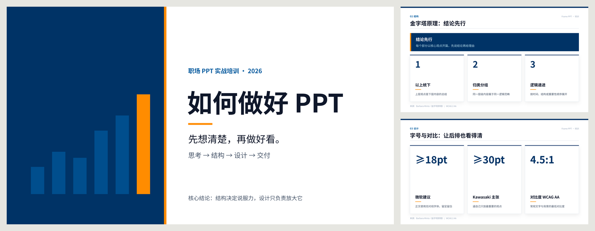
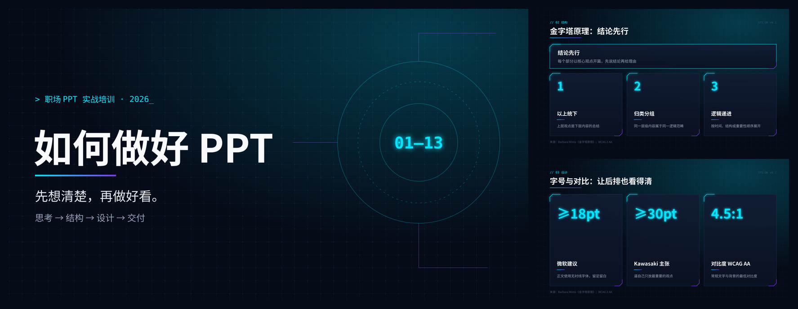
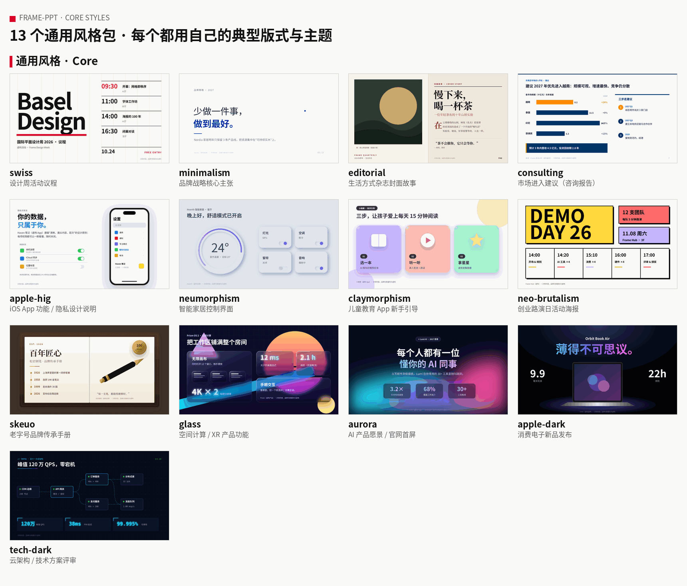
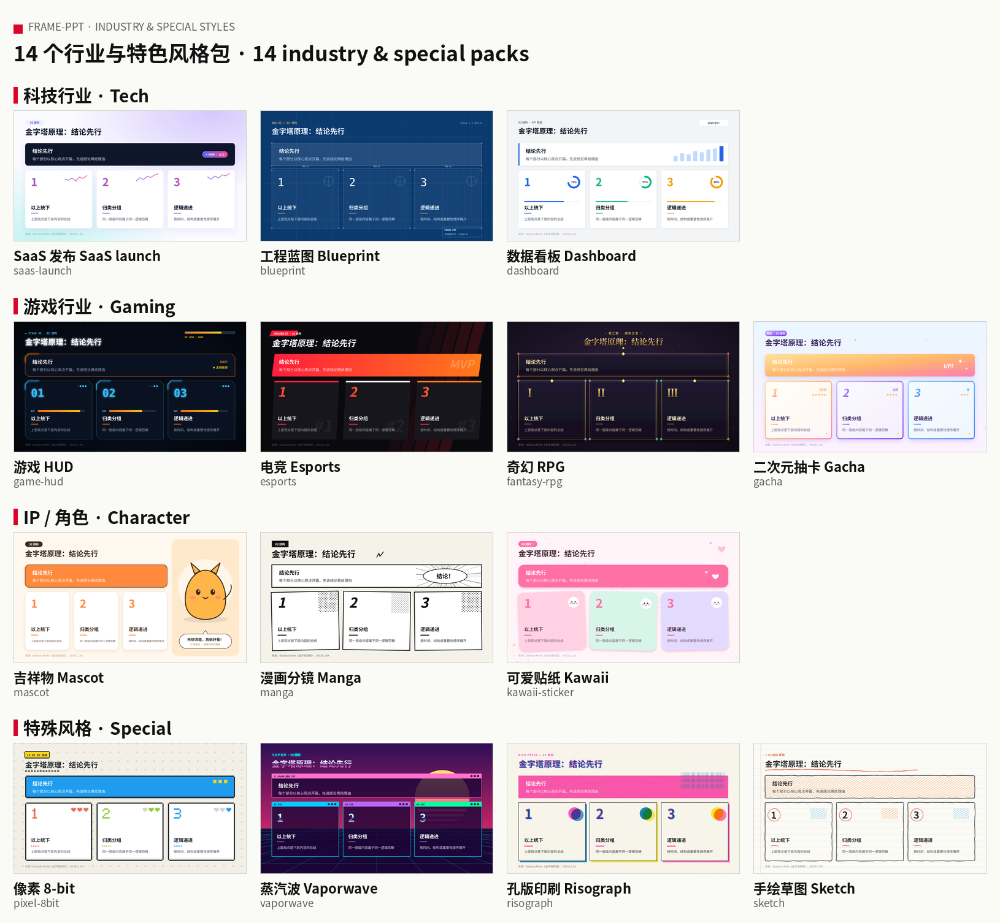

**English** | [简体中文](README.zh-CN.md)

# frame-ppt

> A PPT skill for AI agents: say `frame` and go from a rough idea to a polished, ready-to-present deck.

> [!IMPORTANT]
> **It's not a one-click page generator.** frame works *with* you to structure the deck: it asks multiple-choice questions about your needs, builds a pyramid-principle outline, reviews the content page by page with you, and only then designs, delivering an editable deck that's ready to present.

## Quick install

Tell your agent (Claude Code, Hermes, or any agent with skills):

```text
Install the skill from https://github.com/ottoprua/frame-ppt into your skills folder.
```

Or install it manually for Claude Code:

```bash
git clone https://github.com/ottoprua/frame-ppt.git ~/.claude/skills/frame-ppt
```

Then just say: **`frame: a 10-page training deck on running good meetings`**

## What you get

**Workflow: structure first, design last**



**Finished slides (swiss pack)**



**Draft → design**: same skeleton, new skin



**Skeuomorphic (skeuo)**



**Glassmorphism (glass)**



**Apple dark** · **Consulting** · **Tech dark**





**13 core style packs on the same slide** (full-size images in [docs/images/styles/](docs/images/styles/)), plus brand colors or a reference image



**Industry & special packs**: 14 more for tech, gaming, IP/character and pixel-style decks (the mascot is an original placeholder you can swap for your own IP)



Export: editable PPTX (each slide embeds its SVG with a PNG fallback) or a single-file HTML.

## Credits & license

[Apache-2.0](LICENSE). Parts of the rules and prompts are adapted from [zhx47/ppt-agent](https://github.com/zhx47/ppt-agent); see [NOTICE.md](NOTICE.md).
