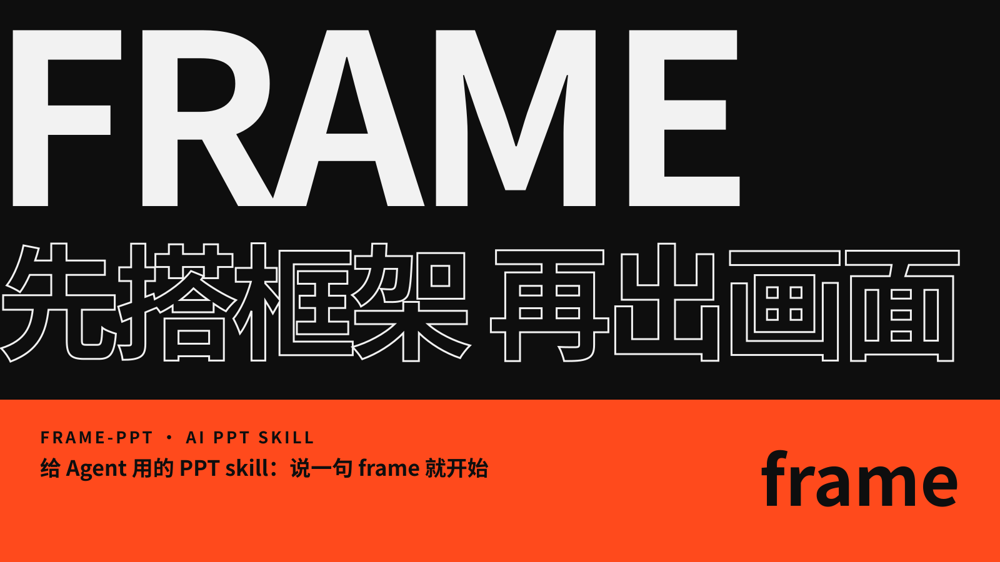
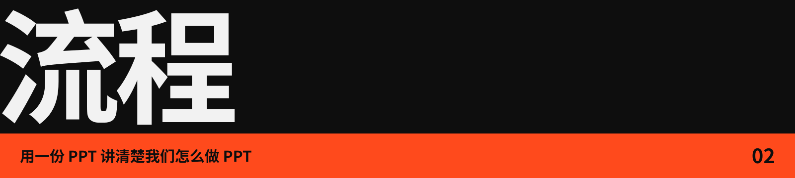
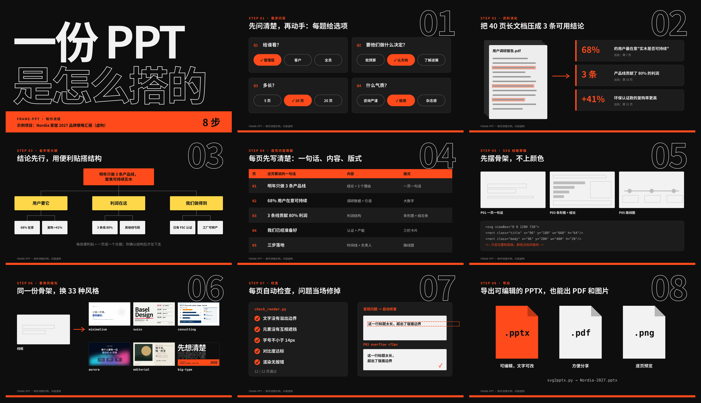
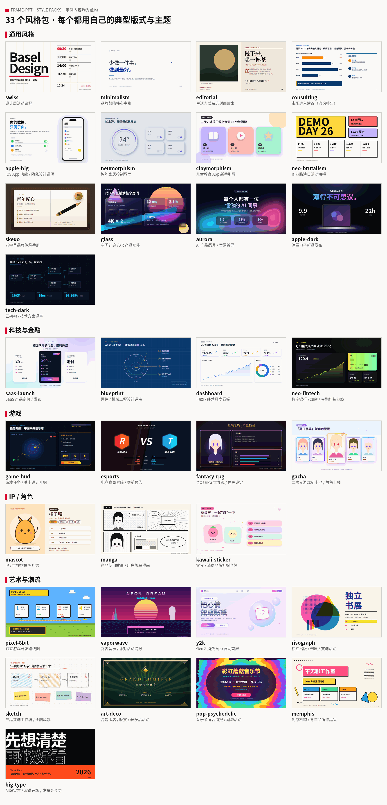

[English](README.md) | 简体中文




**frame-ppt 和你一起把 PPT 的结构搭起来，不是一键出页面的生成器。** 它先问清你的需求，再用金字塔原理搭好大纲。每一页都等你确认之后，才出最终的设计稿。


把下面这句话发给你的 Agent（Claude Code、Codex 等）：

```
帮我安装这个 PPT skill：https://github.com/ottoprua/frame-ppt
```

也可以手动安装：

```bash
git clone https://github.com/ottoprua/frame-ppt.git ~/.claude/skills/frame-ppt
```

装好之后，对 Agent 说一句 **`frame`** 就能开始。

安装时 Agent 会问你插画用什么来画：Agent 自带的生图（Codex、Grok）、本机已登录的 Codex（适合 Hermes、Openclaw），或者单独的 API key；跳过的话，frame-ppt 只用本地生成器和内置 SVG，不会调用付费接口。



下面这份 9 页的 PPT（封面 + 8 个步骤）也是用 frame-ppt 做的，讲的是它怎么做 PPT：需求问答、资料消化、金字塔大纲、逐页简报、SVG 线框、套用风格包，最后检查并导出。单页大图在 [docs/images/process/zh](docs/images/process/zh)。




33 个风格包，每个都有自己的典型版式和主题。图中的品牌和数据都是虚构的示例。



**可选：插画与生成式背景（第 6.5 步，默认关闭）。** 页面上可以给插画、产品线稿、背景留出槽位。点线网络、流场线、半调点阵这类背景直接在本地按配色 token 生成；插画通过文件清单交给其他 Agent 或图像工具。每个风格包都有一套提示词预设，会和你的项目主题组合起来用；付费的图像调用一定先问你。返回的单色图会自动重着色到风格包的配色；缺图或检查不通过时，退回内置 SVG。

---

Apache-2.0 License · 致谢与第三方许可见 [NOTICE.md](NOTICE.md)
