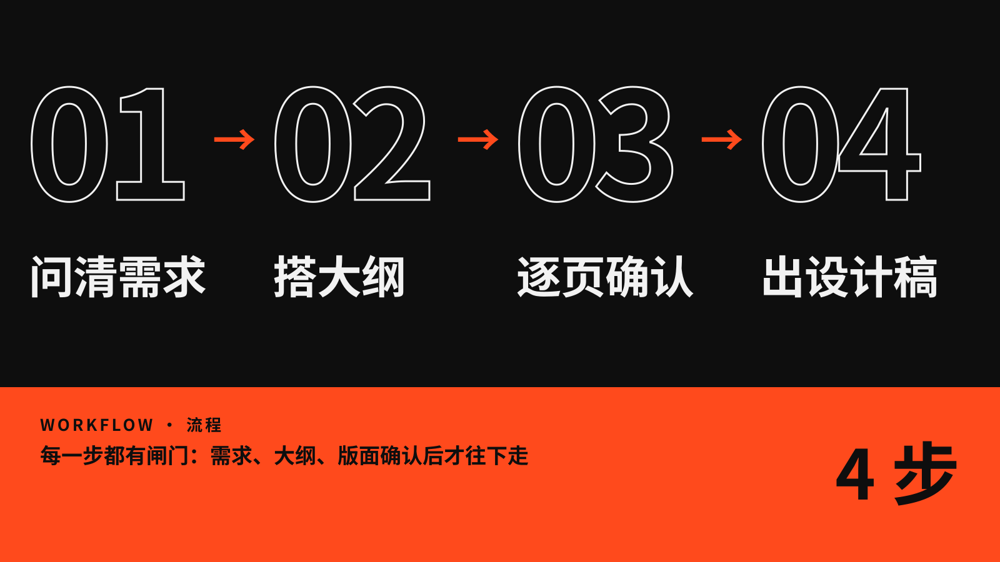

[English](README.md) | 简体中文


**frame-ppt 和你一起把 PPT 的结构搭起来，不是一键出页面的生成器。** 它先问清你的需求，再用金字塔原理搭好大纲。每一页都等你确认之后，才出最终的设计稿。




把下面这句话发给你的 Agent（Claude Code、Codex 等）：

```
帮我安装这个 PPT skill：https://github.com/ottoprua/frame-ppt
```

也可以手动安装：

```bash
git clone https://github.com/ottoprua/frame-ppt.git ~/.claude/skills/frame-ppt
```

装好之后，对 Agent 说一句 **`frame`** 就能开始。


33 个风格包，每个都有自己的典型版式和主题。图中的品牌和数据都是虚构的示例。


高清原图（3840×2160）可以在 Releases 下载。

---

[Apache-2.0](LICENSE) · 致谢与第三方许可见 [NOTICE.md](NOTICE.md)
